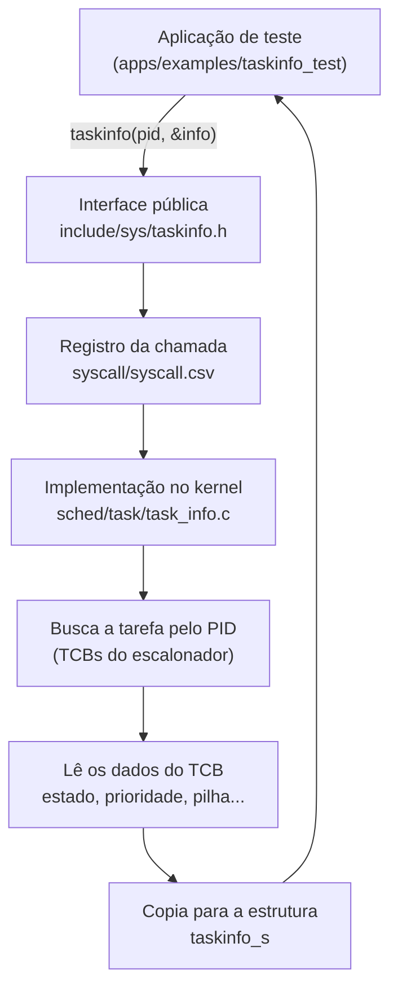
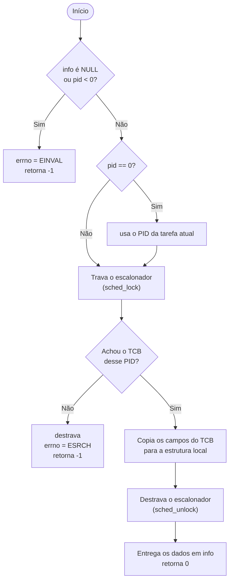

# Solução Proposta: chamada de sistema `taskinfo()` no Apache NuttX

Plataforma: ESP32-DevKitC · Apache NuttX · modelo de compilação FLAT

---

## 1. Ideia da solução

Proponho criar uma nova chamada de sistema chamada `taskinfo()`, da área de **monitoramento de recursos do sistema operacional** (com apoio do **gerenciamento de tarefas**).

A aplicação informa o número de uma tarefa (o PID) e o kernel devolve uma "foto" dela, com:

- nome da tarefa;
- estado (rodando, pronta, dormindo, bloqueada...);
- prioridade e política de escalonamento (FIFO ou Round Robin);
- tamanho da pilha (stack) e quanto dela já foi usado;
- número de vezes que a tarefa foi escalonada (contador de trocas de contexto, parte opcional).

**Por que esta funcionalidade:** o NuttX já oferece informações de tarefas pelo sistema de arquivos `/proc`, mas em formato de texto. A nova chamada devolve uma **estrutura em C**, com todos os campos lidos no mesmo instante, e obriga a trabalhar com estruturas internas do kernel, em especial o TCB (*Task Control Block*), que guarda os dados de cada tarefa.

---

## 2. Visão geral



No modelo FLAT não há separação entre aplicação e kernel, então a chamada se comporta como uma chamada de função comum. Mesmo assim, ela é registrada no `syscall.csv` para que a interface fique completa e também funcione nos modelos PROTECTED e KERNEL.

---

## 3. Interface pública

Arquivo novo: `nuttx/include/sys/taskinfo.h`

```c
struct taskinfo_s
{
  pid_t    pid;                             /* PID da tarefa                  */
  char     name[CONFIG_TASK_NAME_SIZE + 1]; /* Nome da tarefa                 */
  uint8_t  state;                           /* Estado (TSTATE_*)              */
  uint8_t  priority;                        /* Prioridade atual               */
  uint8_t  policy;                          /* SCHED_FIFO ou SCHED_RR         */
  size_t   stack_size;                      /* Tamanho total da pilha (bytes) */
  size_t   stack_used;                      /* Pilha já usada (bytes)         */
  uint32_t switches;                        /* Vezes que foi escalonada       */
};

/* Retorna 0 em sucesso; -1 com errno definido em caso de erro. */
int taskinfo(pid_t pid, FAR struct taskinfo_s *info);
```

Regras de uso:

- `pid == 0` significa "a própria tarefa que chamou";
- `info` não pode ser `NULL`.

### Tratamento de erros

| Situação | Retorno | `errno` |
|----------|---------|---------|
| `info == NULL` | -1 | `EINVAL` |
| `pid < 0` | -1 | `EINVAL` |
| PID não existe (ou a tarefa já terminou) | -1 | `ESRCH` |
| Sucesso | 0 | – |

Segui a convenção do NuttX e do POSIX: retorno -1 com o motivo em `errno`.

---

## 4. Funcionamento interno

Arquivo novo: `nuttx/sched/task/task_info.c`



### Estruturas e funções internas utilizadas

| Elemento | Uso nesta solução |
|----------|-------------------|
| `struct tcb_s` (TCB) | Guarda os dados de cada tarefa: estado, prioridade, pilha e nome |
| `nxsched_get_tcb(pid)` | Encontra o TCB a partir do PID |
| `this_task()` | Devolve o TCB da tarefa em execução (usado quando `pid == 0`) |
| `sched_lock()` / `sched_unlock()` | Impedem que a tarefa seja trocada ou removida enquanto o TCB é lido |
| Campos `task_state`, `sched_priority`, `flags`, `adj_stack_size` e `name` do TCB | Origem das informações devolvidas |
| `up_check_tcbstack()` (ou equivalente da versão usada) | Calcula quanto da pilha já foi usado |

### Sincronização e concorrência

Se outra tarefa terminar ou mudar de estado enquanto o TCB está sendo lido, os dados podem ficar inconsistentes, ou o ponteiro pode apontar para memória já liberada. Para evitar isso:

1. o escalonador é travado (`sched_lock`) antes de buscar o TCB;
2. todos os campos são copiados para uma estrutura **local** ainda com o escalonador travado;
3. o escalonador é destravado e só então o resultado é entregue à aplicação.

A região travada é curta, o que mantém o impacto sobre o comportamento de tempo real pequeno. Como o ESP32 tem dois núcleos, será avaliado se `sched_lock()` basta ou se é preciso usar `enter_critical_section()` para proteger a leitura do TCB.
